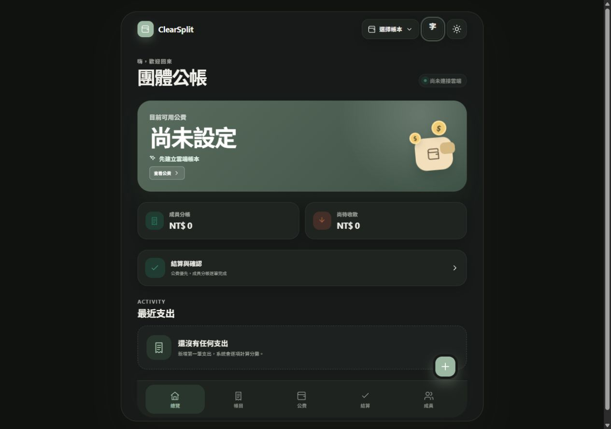

# ClearSplit Core

**A chat-native, auditable group ledger. Messages become drafts—not money movements.**

[繁體中文](README.zh-TW.md) · [Architecture](docs/architecture.md) · [Messaging providers](docs/messaging-providers.md) · [Accounting rules](docs/accounting.md)



ClearSplit solves a narrow problem that generic expense splitters usually leave to manual coordination: a group member reports a shared-fund expense where the conversation already happens, while the ledger's responsible member retains a verifiable review gate.

```text
LINE / Discord / Telegram
          │ signed webhook
          ▼
 normalized message → idempotent draft → human review → public-fund journal
                                                │
                                     PostgreSQL invariants
```

## Why this is different

- **Chat-native intake.** LINE `#記帳`, Telegram `/expense`, and Discord `/clearsplit expense` share one parser and processing contract.
- **Draft-only bots.** A compromised bot credential cannot use the webhook path to confirm a transaction. Confirmation requires the authenticated responsible member.
- **Auditable identity.** A conversation binding and a personal member link are separate, short-lived, one-time operations.
- **Durable idempotency.** Provider plus event ID forms the lease key, so retries are safe and equal IDs from different providers do not collide.
- **Accounting enforced in PostgreSQL.** Public-fund balance, journal lines, member attribution, duplicate review, archive read-only behavior, and two-sided settlement do not depend on UI correctness.
- **Deployable reference app.** React 19, TypeScript, Vite 8, Supabase Postgres/Auth/Edge Functions, and an installable PWA are included.

## Supported messaging providers

| Provider | Intake command | Request verification | Group behavior |
| --- | --- | --- | --- |
| LINE | `#記帳 Dinner 400` | HMAC-SHA256 signature | Text events in a bound LINE group |
| Discord | `/clearsplit expense title:Dinner amount:400` | Ed25519 interaction signature | Slash commands in a bound server channel |
| Telegram | `/expense Dinner 400` | Webhook secret header | Slash commands work with privacy mode enabled |

All three providers use the same workflow:

1. The responsible member creates a provider-scoped group bind code in the web app.
2. `/bind CODE` (or the provider equivalent) connects one group/channel to one ledger.
3. The responsible member creates a personal code for a ledger member.
4. That person runs `/link CODE` once.
5. Expense commands create pending drafts. The responsible member reviews, rejects, or confirms them in ClearSplit.

See [docs/messaging-providers.md](docs/messaging-providers.md) for exact setup and commands.

## Quick start

Requirements: Node.js 20+, Corepack/pnpm, Docker Desktop, and Supabase CLI.

```bash
git clone https://github.com/lk242/clearsplit-core.git
cd clearsplit-core
corepack pnpm install --frozen-lockfile
copy .env.example .env.local
supabase start
supabase db reset
corepack pnpm dev
```

On macOS or Linux, replace `copy` with `cp`. Populate only browser-safe values in `.env.local`. Put webhook credentials in Supabase secrets, never in a `VITE_` variable.

```bash
supabase secrets set --env-file supabase/.env
supabase functions deploy line-member
supabase functions deploy line-webhook
supabase functions deploy discord-webhook
supabase functions deploy telegram-webhook
```

## Verification

```bash
corepack pnpm test       # parser, domain, auth and i18n unit tests
corepack pnpm lint       # Oxlint
corepack pnpm build      # TypeScript and production bundle
supabase test db         # migrations, RLS/RPC and financial invariants
```

The repository currently contains 86 JavaScript/TypeScript tests and 9 transactional PostgreSQL test files. The exact count may increase; CI runs the commands rather than trusting this sentence.

## Extension boundaries

The boundaries are intentionally explicit about what is interchangeable today:

- **Add a messaging provider:** normalize its verified request to `IncomingMessage`, reuse the shared processor, and implement the provider reply transport. This is a working plug-in boundary.
- **Replace the frontend:** call the documented Supabase tables/RPCs or build another client. No accounting rule requires this React UI.
- **Replace Supabase:** possible, but not a drop-in swap. A new backend must implement the repository contract *and* port the PostgreSQL invariants, authorization, transactions, and idempotency semantics. See [docs/adapter-contracts.md](docs/adapter-contracts.md).
- **Authentication:** the included reference web app still uses LINE Login for verified web sessions. Discord and Telegram are complete messaging intake adapters, not alternative web-login providers.

This distinction matters: interfaces make the seams clear; they do not pretend financial consistency is portable for free.

## Internationalization

Bot replies automatically select English or Traditional Chinese from provider locale data, with LINE defaulting to Traditional Chinese. The reference UI includes a persisted `en` / `zh-TW` locale switch for its application shell. Existing accounting forms are still being migrated from Traditional Chinese literals; translation contributions are welcome and should use the typed dictionary in `src/i18n.tsx`.

## Project layout

```text
src/                                  React reference client and domain tests
supabase/migrations/                  Transactional schema and invariants
supabase/functions/_shared/messaging  Provider-neutral command and draft core
supabase/functions/*-webhook/         LINE, Discord and Telegram adapters
supabase/tests/                       Transactional database verification
docs/                                 Architecture, setup and accounting contracts
```

## Status and license

ClearSplit Core is an early public beta. Use a separate Supabase project and test with non-sensitive data before operating a real group ledger. See [SECURITY.md](SECURITY.md) for private vulnerability reporting.

Licensed under [Apache-2.0](LICENSE).
