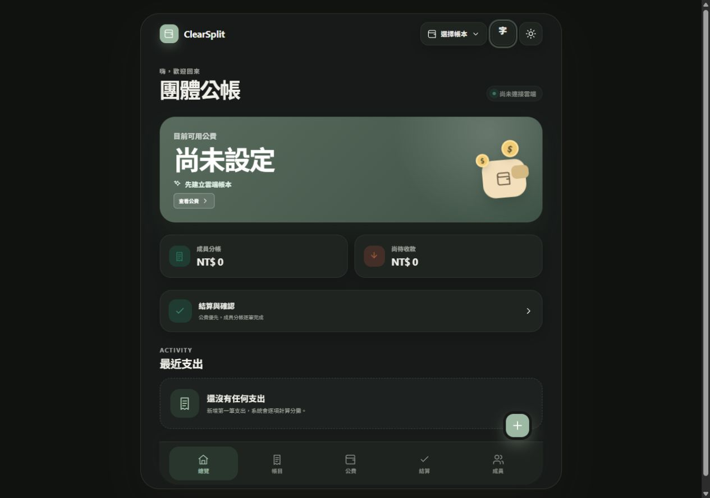

# ClearSplit Core

**聊天原生、可稽核的團體公帳：訊息只會變成草稿，不會直接動到錢。**

[English](README.md) · [架構](docs/architecture.md) · [通訊服務設定](docs/messaging-providers.md) · [帳務規則](docs/accounting.md)



ClearSplit 解決的是一般分帳工具常留給人工協調的一段流程：成員直接在原本聊天的地方回報公費支出，但正式入帳前仍由帳務負責人核對，而且每一筆來源都能追查。

```text
LINE / Discord / Telegram
          │ 驗證過的 webhook
          ▼
  統一訊息 → 防重送草稿 → 人工核對 → 公費交易日誌
                                      │
                               PostgreSQL 帳務約束
```

## 主要差異

- LINE `#記帳`、Telegram `/expense`、Discord `/clearsplit expense` 共用同一套解析與處理契約。
- Bot 永遠只建立草稿；正式入帳必須由已登入的帳務負責人操作。
- 群組綁定與個人成員身分連結分成兩個短效、一次性步驟。
- 以「provider + event ID」做持久化租約，重送不會重複建立草稿，不同服務的相同 ID 也不衝突。
- 公費不可為負、分錄守恆、來源成員、疑似重複、封存唯讀與雙向確認都由 PostgreSQL 強制。
- 內含 React 19／TypeScript／Vite 8／Supabase／PWA 的可部署參考實作。

## 三種通訊服務

| 服務 | 記帳格式 | 請求驗證 |
| --- | --- | --- |
| LINE | `#記帳 晚餐 400` | HMAC-SHA256 簽章 |
| Discord | `/clearsplit expense title:晚餐 amount:400` | Ed25519 interaction 簽章 |
| Telegram | `/expense 晚餐 400` | webhook secret header |

完整流程是：負責人先產生群組綁定碼，將群組或頻道連到帳本；再替每位成員產生個人連結碼。成員連結身分後，訊息才可以建立有來源紀錄的草稿。詳細設定見 [docs/messaging-providers.md](docs/messaging-providers.md)。

## 本機執行與驗證

需要 Node.js 20+、Corepack/pnpm、Docker Desktop 與 Supabase CLI。

```bash
git clone https://github.com/lk242/clearsplit-core.git
cd clearsplit-core
corepack pnpm install --frozen-lockfile
copy .env.example .env.local
supabase start
supabase db reset
corepack pnpm dev
```

```bash
corepack pnpm test
corepack pnpm lint
corepack pnpm build
supabase test db
```

目前有 86 個 JavaScript／TypeScript 測試與 9 份可回滾的 PostgreSQL 測試檔；CI 會實際執行上述命令。

## 哪些層真的能替換

- 新增通訊服務：這是目前完整可用的 plug-in 邊界。驗證 provider request、轉成 `IncomingMessage`、共用 processor，再實作回覆即可。
- 更換前端：可以直接使用既有 Supabase table／RPC，不必採用這套 React UI。
- 更換後端：可以做，但不是換一個 URL 就完成。必須同時實作 repository contract，並移植交易、權限、防重送與帳務不變量。詳見 [docs/adapter-contracts.md](docs/adapter-contracts.md)。
- 登入：參考前端目前仍使用 LINE Login 建立可驗證的 web session；Discord／Telegram 已完成的是訊息輸入 adapter，不是 web login provider。

## i18n 狀態

Bot 回覆會依服務提供的 locale 自動使用英文或繁體中文；LINE 預設繁中。參考 UI 已提供會保存在本機的 `en`／`zh-TW` 切換，主框架已完成 key-based 翻譯；既有帳務表單仍在逐步從繁中文字面值搬到 typed dictionary。

這是 early public beta。正式使用前請建立獨立 Supabase project，並先用非敏感資料測試。授權條款為 [Apache-2.0](LICENSE)。
